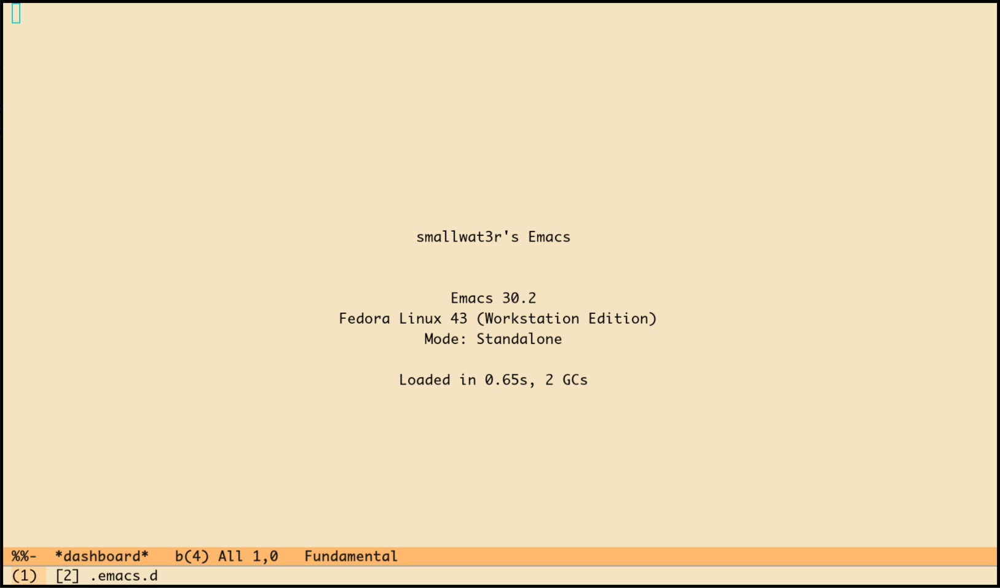

# smallwat3r's Emacs

Personal Emacs configuration in vanilla elisp. Requires Emacs 30+.



After years of using [Doom Emacs](https://github.com/doomemacs/doomemacs), many
keybindings and workflows here are influenced by it.

## Installation

Clone or symlink to `~/.emacs.d` and start Emacs. Packages install automatically
on first run.

## Package management

Packages are managed with [elpaca](https://github.com/progfolio/elpaca), which
provides async installation and version locking. Packages install automatically
when Emacs starts. The lockfile `elpaca-lock.el` is version-controlled for
reproducible installs.

Common commands (run in Emacs after startup):

- `M-x elpaca-update-all` - update all packages
- `M-x elpaca-write-lock-file` - save current versions to lockfile

Run `make` to see available commands:

```
$ make
  help       Show this help
  link       Symlink this directory to ~/.emacs.d
  check      Smoke test: load config and activate deferred modes in batch
  clean      Remove all installed packages
```

## Claude Code sandbox

Claude Code runs inside a Docker container for sandboxing. The wrapper script
and image live in their own repository,
[claude-sandbox](https://github.com/smallwat3r/claude-sandbox), checked out at
`~/code/claude-sandbox` (see its README for what the sandbox does). `lisp/sw-claude.el` finds
`claude-docker` on the `PATH`, falling back to that checkout.

Extra project directories can be mounted with `M-x sw-claude-with-dirs`. To
upgrade the pinned versions in the Dockerfile, then rebuild the image:

```
M-x sw-claude-upgrade-sandbox
M-x sw-claude-rebuild-sandbox
```
